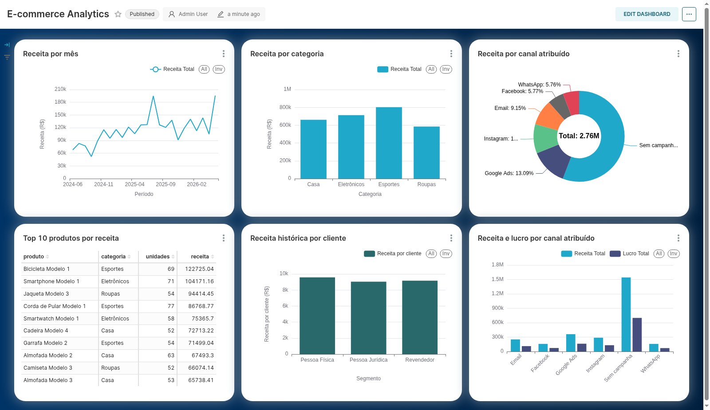

# Data lake de e-commerce com arquitetura medalhão

Pipeline que integra vendas (CSV) e marketing (JSON) em três camadas, Bronze, Silver e Gold,
e entrega um modelo dimensional para SQL e dashboard.

**Os dados são 100% sintéticos.**



## O que o projeto faz

- Ingere as fontes **sem alterar um byte**, com horário e hash nos metadados.
- Valida os dados e **registra o motivo de cada linha rejeitada**.
- Cruza e-commerce e marketing com **atribuição de último toque em 30 dias**.
- Modela em **esquema estrela**, com uma tabela fato e quatro dimensões.
- Responde a **11 perguntas de negócio em SQL**.
- Sobe um **dashboard versionado**, importado automaticamente no Superset.

## Arquitetura

```
E-commerce (CSV) ─┐
                  ├─> Bronze ────> Silver ────> Gold ────> DuckDB ──> Superset
Marketing (JSON) ─┘   original     validado     estrela    gold.db
                      └──────── RustFS (S3) ────────┘
```

| Ferramenta | Versão | Papel |
|---|---|---|
| RustFS | 1.0.4 | Armazenamento compatível com S3 |
| Python e pandas | 3.11+ e 2.3 | Ingestão e transformação |
| Parquet (PyArrow) | 23 | Formato da Silver e da Gold |
| DuckDB | 1.4 | Consultas analíticas |
| Apache Superset | 4.1 | Dashboard |
| pytest | 9 | Testes |

## Como rodar

Requer Python 3.11+, Docker com Compose e internet na primeira execução.

```bash
python3 -m venv .venv
source .venv/bin/activate
pip install -r requirements.txt

python criar_env.py              # cria o .env com senhas aleatórias
docker compose up -d --wait      # sobe RustFS e Superset (a primeira vez demora)
python run.py                    # roda o pipeline inteiro
```

| Serviço | Endereço | Acesso |
|---|---|---|
| Dashboard | http://localhost:8088/superset/dashboard/ecommerce-analytics/ | `admin` e `SUPERSET_ADMIN_PASSWORD` do `.env` |
| Console do RustFS | http://localhost:9001/rustfs/console/ | `RUSTFS_ACCESS_KEY` e `RUSTFS_SECRET_KEY` do `.env` |

Se alguma porta estiver ocupada, defina `RUSTFS_PORT`, `RUSTFS_CONSOLE_PORT` ou `SUPERSET_PORT` no `.env`.

```bash
python -m pytest                 # testes, não precisam de Docker
docker compose down              # para os serviços e mantém os dados
```

## Estrutura

```
scripts/            etapas 00 a 05 do pipeline
sql/                as 11 consultas, usadas no pipeline, nos testes e no dashboard
superset/           imagem e dashboard como código
tests/              testes das regras
docs/               documentação técnica e das consultas
config.py           configuração
storage.py          acesso ao S3
setup_storage.py    criação dos buckets
run.py              executa tudo em ordem
```

## Documentação

- [Documentação técnica](docs/documentacao.md): camadas, regras, modelo e decisões
- [Consultas](docs/queries.md): o que cada uma responde e como ler
- [Correções desta versão](docs/correcoes.md): o que estava errado e como foi resolvido

## Limitações

- Os dados são aleatórios. As diferenças entre canais, categorias e descontos **não são conclusões de negócio**.
- Atribuição mostra associação, e não que a campanha causou a venda.
- O custo é o do cadastro do produto, sem histórico.
- Cada execução refaz tudo, sem carga incremental.
- É um ambiente local: um nó de storage, sem redundância nem TLS, e Superset com SQLite.

## Origem

Evolução de um trabalho acadêmico feito em dupla na UFAL. Este repositório é a minha versão,
com as correções descritas em [docs/correcoes.md](docs/correcoes.md).
